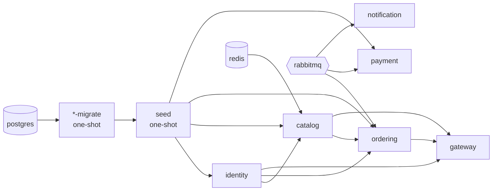

# Running in containers

Every app has a Docker image, and `docker-compose.yml` can run the whole system: the infrastructure, one-shot database migrations, the five services and the gateway. Running the apps with `dotnet run` against only the infrastructure still works, as before.

## Contents

- [Run it](#run-it)
- [How it is built](#how-it-is-built)
- [Startup order](#startup-order)
- [Configuration and secrets](#configuration-and-secrets)
- [Differences from running locally](#differences-from-running-locally)
- [Published images](#published-images)
- [Running in a cluster](#running-in-a-cluster)

## Run it

Create `.env` (see [configuration](configuration.md#docker-environment)), fill in `STRIPE_SECRET_KEY` with a test key, and make sure the signing key exists (`scripts/setup-user-secrets.sh` creates `~/shopshop-keys/jwt-private.pem`). Then:

```bash
docker compose up -d --build
```

Only the gateway is published: http://localhost:5080 (change it with `GATEWAY_PORT`). The services are reachable only inside the compose network. To start just the infrastructure and run the apps with `dotnet run`, name the services: `docker compose up -d postgres rabbitmq redis lgtm`.

```bash
docker compose down      # stop the apps and the infrastructure, keep the data
```

## How it is built

- One `Dockerfile` at the repo root builds any app. The compose file passes `PROJECT` (the project to publish) and `DLL` (its entry assembly). The build context is the repo root because the apps share `BuildingBlocks.*`.
- Two stages: `dotnet/sdk:10.0` publishes, `dotnet/aspnet:10.0` runs. The app runs as the image's non-root user and listens on port 8080.
- `logs/` belongs to group 0 with the owner's rights, so the app can also write it when a platform such as OpenShift runs the container as a random UID in group 0.
- `curl` is installed in the final image for the healthchecks, because the base image does not include it.
- `.dockerignore` keeps `bin/`, `obj/`, `tests/`, `docs/`, `.github/` and `.env` out of the build context.

## Startup order



- **Migrations.** Identity, Catalog, Ordering and Payment each have a `<service>-migrate` container. It starts the same image with the argument `--migrate`, applies the EF migrations and exits. Outside Development the apps never migrate on their own startup.
- **Mock data.** When all four migrations have finished, the `seed` container loads `scripts/seed/<Database>.sql` with `psql` and exits. Identity, Catalog, Ordering and Payment start only after it completes successfully. It never overwrites existing rows. See [mock data](seed-data.md) for the accounts and contents.
- **Health.** Every app answers `GET /health` on port 8080. Compose waits for `service_healthy` before starting what depends on it.
- **Consumers.** Payment, Ordering and Notification create their queues on their first start, so one `up` takes care of the "run every consumer once" step from [messaging](messaging.md#start-every-consumer-at-least-once).

## Configuration and secrets

Containers run in the Production environment, so `appsettings.Development.json` is not read. Everything an app needs comes from environment variables in `docker-compose.yml` (`Section__Key` maps to `Section:Key`):

| What | How |
|---|---|
| Connection strings | `ConnectionStrings__<Name>`, built from `POSTGRES_USER` / `POSTGRES_PASSWORD` in `.env` and the `postgres`, `redis` host names |
| RabbitMQ | `RabbitMq__HostName`, `RabbitMq__UserName`, `RabbitMq__Password` |
| JWT | Identity issues tokens with issuer `http://identity:8080`. Catalog and Ordering read its discovery document over plain HTTP, so they set `JwtSettings__RequireHttpsMetadata=false` |
| Gateway | `Cors__AllowedOrigins__0` (`CORS_ORIGIN`, default `http://localhost:3000`) and one `ReverseProxy__Clusters__<name>__Destinations__primary__Address` per service |
| Telemetry | `OTEL_EXPORTER_OTLP_ENDPOINT=http://lgtm:4317` |
| Swagger | `OpenApi__Enabled=true` on the gateway, Identity, Catalog and Ordering |

The two real secrets are not environment variables. Compose mounts them as files under `/run/secrets`, and Identity and Payment read that directory as configuration (a file named `JwtSettings__PrivateKeyPem` becomes `JwtSettings:PrivateKeyPem`):

| Secret | Source |
|---|---|
| `JwtSettings__PrivateKeyPem` (Identity) | the file `JWT_PRIVATE_KEY_FILE`, default `~/shopshop-keys/jwt-private.pem` |
| `Stripe__SecretKey` (Payment) | `STRIPE_SECRET_KEY` from `.env` |

Environment variable names must not contain a hyphen. The image starts the app through `sh`, which drops such variables, so use names like `primary` for cluster destinations.

## Differences from running locally

- Swagger is on even though the containers run as Production, because compose sets `OpenApi__Enabled=true` on the gateway, Identity, Catalog and Ordering. Open the combined UI at http://localhost:5080/swagger. Leave the flag off in any environment that is reachable from outside.
- `UseHttpsRedirection()` stays in the apps but does nothing here: no HTTPS port is configured, so the middleware logs `Failed to determine the https port for redirect` and passes the request on. TLS belongs to whatever sits in front of the gateway.
- Logs go to the console as JSON, and also to `logs/` inside the container, which is thrown away with it. Traces, metrics and logs reach Grafana at http://localhost:3000.
- The first start creates the databases and tables in the `postgres_data` volume and loads the [mock data](seed-data.md). Deleting that volume resets the data.

## Published images

`.github/workflows/ci.yml` runs on every pull request and on every push to `development`:

1. **test**: `dotnet test ShopShop.slnx`. The integration tests start Postgres and RabbitMQ with Testcontainers on the runner's Docker.
2. **images**: after the tests pass, builds the six apps in parallel from the same `Dockerfile` with the same `PROJECT` and `DLL` values as `docker-compose.yml`.

Pull requests only build the images. Pushes to `development` also publish them to GitHub Container Registry:

| Image | Tags |
|---|---|
| `ghcr.io/gurungsh/shopshop-<app>` for `identity`, `catalog`, `ordering`, `payment`, `notification`, `gateway` | the commit SHA, and `latest` |

Deploy by SHA, not `latest`, so that every environment runs a known build. The packages are private when first published. To let a cluster pull them, either make each package public in its GitHub settings, or give the cluster a pull secret made from a GitHub token with `read:packages`. The images are built for `linux/amd64` only.

## Running in a cluster

What a Kubernetes or OpenShift deployment needs from these images, beyond the configuration and secrets above:

- **Migrations**: run the app image once with the argument `--migrate`, as a Job, before rolling out the new version.
- **Probes**: `GET /health` on port 8080, for readiness and liveness.
- **Secrets**: mount them as files under `/run/secrets`, named like the configuration key (`JwtSettings__PrivateKeyPem`, `Stripe__SecretKey`).
- **Forwarded headers**: behind an Ingress or Route, every request reaches the gateway from the router's address. Set `ASPNETCORE_FORWARDEDHEADERS_ENABLED=true` on the gateway so that it reads the client address from `X-Forwarded-For`. Without it, the rate limiter puts every user in one bucket of 100 requests per minute. The setting trusts the header from any sender, so use it only where the router is the only way in. Leave it off in `docker-compose.yml`, where the gateway port is published directly and a client could send a fake header to avoid the limit.
- **Random UID**: works without changes (see [How it is built](#how-it-is-built)).

